<!-- readme-atelier:start -->
<!-- Generated by Readme Atelier (https://github.com/monokernn/readme-atelier). Edit atelier.yml instead of this block. -->

  &nbsp;
  

  
  

  
  
  
  

<!-- readme-atelier:end -->
